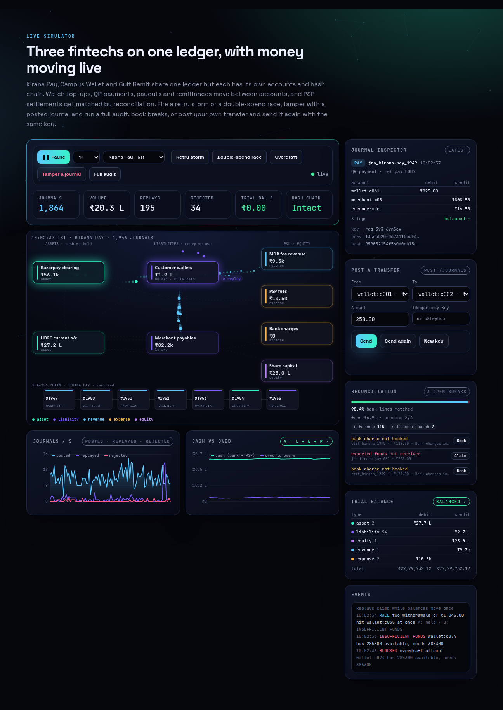
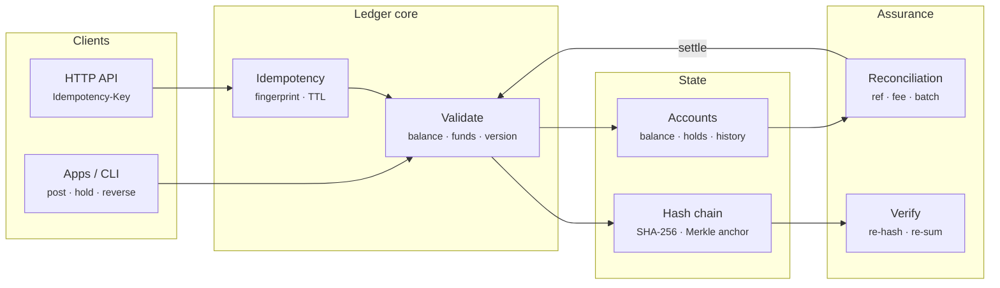
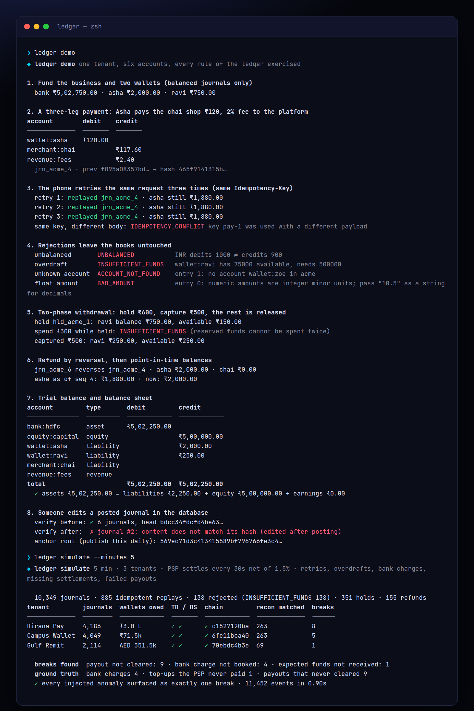
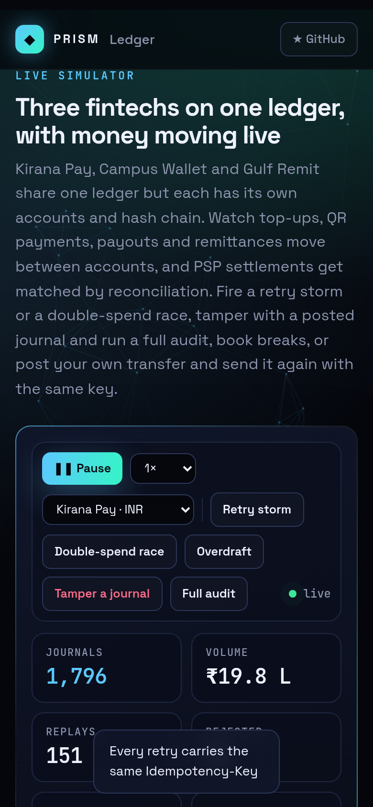

<!-- Prism Systems 10/49 -->
<p align="center">
  
</p>

<p align="center">
  
</p>

<p align="center">
  <a href="https://github.com/krishyaa06/prism-ledger/actions/workflows/ci.yml"></a>
  <a href="https://krishyaa06.github.io/prism-ledger/"></a>
  
  
  
  <a href="LICENSE"></a>
</p>

<p align="center">
  <a href="https://krishyaa06.github.io/prism-ledger/"><b>Live simulator</b></a> ·
  <a href="docs/ARCHITECTURE.md"><b>Architecture</b></a> ·
  <a href="docs/USAGE.md"><b>Docs</b></a> ·
  <a href="#-quick-start"><b>Quick start</b></a>
</p>

<p align="center">
  <a href="https://krishyaa06.github.io/prism-ledger/"></a>
</p>


## ⚡ Overview

In a wallet or payments business, the ledger is the source of truth for who owns what. It has to hold up against mobile retries, concurrent requests, partial captures, refunds, processors that settle in batches net of fees, banks that add charges, and anyone with database access. Prism Ledger implements the patterns used by modern ledger services (double-entry with per-currency balancing, idempotency, holds, immutable history), adds cryptographic tamper evidence, and closes the loop with reconciliation against the bank.

## ✨ Features

| | Feature | Details |
| :-: | --- | --- |
| ⚖ | **Double-entry, per currency** | Every journal needs at least two legs, and debits must equal credits within each currency. Multi-currency journals (such as FX remittances) balance through position accounts. All amounts are integer minor units, never floats. |
| ⚛ | **Atomic by construction** | A journal is fully validated before any change is applied, so applying it can't fail halfway. Batches are all-or-nothing and roll back balances, the chain head and idempotency keys. |
| ↺ | **Idempotency keys** | Retrying with the same key and payload returns the original journal (HTTP 200 with `Idempotent-Replayed`). The same key with a different body is a 409. Keys expire after a TTL. |
| ⏸ | **Two-phase holds** | Funds can be reserved, then captured in full or in part, voided or left to expire. Available balance is balance minus holds, so reserved money can never be spent twice. |
| ⛓ | **Tamper-evident history** | Each journal's hash covers its canonical JSON plus the previous hash. Verification re-hashes the chain and re-sums every balance, catching edits, deletions, reordering and direct balance changes. |
| ⌖ | **Point-in-time balances** | Each account keeps its balance after every journal, so balances as of any time or sequence number come from a binary search. Statements show running balances, and trial balances can be taken at any point. |
| ⇄ | **Reconciliation** | Matches run in order: reference, amount + date, net of an exact processor fee, then settlement batches (a contiguous run first, then a bounded subset sum). The engine also detects a batch where the processor left out exactly one item. |
| ⚡ | **HTTP API + CLI** | Tenants, accounts, journals (with an `Idempotency-Key` header), holds, reversals, trial balance, balance sheet, verify, export and reconcile. The CLI covers demo, simulate, recon, verify, bench and serve. |

## 🏗️ Architecture



### How it works

1. **Normalise** — Each leg is resolved to an account in this tenant. Sides are checked, string amounts are parsed into exact minor units, and currencies must match the account.
2. **Replay check** — If the idempotency key was seen within the TTL, the payload fingerprints are compared: a match replays the original journal, a mismatch is a conflict.
3. **Validate** — The engine checks that debits equal credits per currency and that no account is frozen. It also checks optimistic version preconditions, and that no account without overdraft would end up below its holds.
4. **Apply + chain** — Balances, versions and per-account history are updated, then the journal is hashed onto the tenant's chain. Nothing in this step can fail.
5. **Reconcile** — Expected cash movements are matched to bank lines. Matching a settlement batch posts the bank and fee journal, and leftover lines become categorised breaks an operator can book.

More detail in [docs/ARCHITECTURE.md](docs/ARCHITECTURE.md).

## 🚀 Quick Start

**Try it in the browser:** [https://krishyaa06.github.io/prism-ledger/](https://krishyaa06.github.io/prism-ledger/), no install needed.

```bash
# CLI, no install
npx github:krishyaa06/prism-ledger --help

# add the engine to a project
npm install github:krishyaa06/prism-ledger
```

### JavaScript API

```js
import { Ledger, reconcile } from "prism-ledger";

const L = new Ledger();
L.createTenant("acme", { currency: "INR" });
L.openAccount("acme", { code: "bank:hdfc", type: "asset" });
L.openAccount("acme", { code: "wallet:asha", type: "liability" });
L.openAccount("acme", { code: "merchant:chai", type: "liability" });
L.openAccount("acme", { code: "revenue:fees", type: "revenue" });

L.post("acme", { key: "tp-1", entries: [{ account: "bank:hdfc", dr: "2000" }, { account: "wallet:asha", cr: "2000" }] });

// three legs, strings are exact decimals, integers are minor units (paise)
const { journal, replay } = L.post("acme", {
  key: "pay-1", memo: "QR payment",
  entries: [{ account: "wallet:asha", dr: "120" }, { account: "merchant:chai", cr: "117.60" }, { account: "revenue:fees", cr: "2.40" }],
});
L.post("acme", { key: "pay-1", /* same body */ ... }).replay;     // true: retries never double-post

const { hold } = L.hold("acme", { account: "wallet:asha", to: "bank:hdfc", amount: "600" });
L.commit("acme", hold.id, { amount: "500" });                        // capture part, release the rest
L.reverse("acme", journal.id);                                       // refund
L.balance("acme", "wallet:asha", { asOf: Date.parse("2026-10-01") });
L.trialBalance("acme").balanced;                                     // true
L.verify("acme");                                                    // { ok, checked, head } or where it broke
L.anchor().root;                                                     // Merkle root over every tenant chain

reconcile(expectedLines, bankLines, { settlementBps: 150 });         // matches + categorised breaks
```

| Export | What it does |
|---|---|
| `new Ledger({ clock, idempotencyTTL })` | The ledger |
| `.createTenant(id, { name, currency })` · `.openAccount(t, { code, type, currency, allowNegative })` · `.freeze(t, code)` | Isolation and chart of accounts (`asset`, `liability`, `equity`, `revenue`, `expense`) |
| `.post(t, { key, ref, memo, at, entries, meta, ifVersion })` | Atomic journal → `{ journal, replay }`; errors are `LedgerError` with `code` and HTTP `status` |
| `.postBatch(t, reqs)` · `.reverse(t, id, { key })` | All-or-nothing batches, one-time reversals |
| `.hold(t, { account, to, amount, key, expiresAt })` · `.commit(t, id, { amount })` · `.void(t, id)` · `.expireHolds(t)` | Two-phase transfers |
| `.balance(t, code, { asOf \| asOfSeq })` · `.available(t, code)` · `.statement(t, code)` · `.trialBalance(t)` · `.balanceSheet(t)` | Reads |
| `.verify(t, { fromSeq })` · `.anchor()` · `.export(t)` · `.import(data)` | Integrity and persistence |
| `reconcile(ledger, bank, { dateTol, feeBps, settlementBps, batch })` · `subsetSum` · `parseCSV` | Reconciliation |
| `toMinor` · `fmtMoney` · `fmtShort` · `allocate` · `bps` · `CURRENCIES` | Exact money helpers |
| `new Platform({ seed, rate, settleEvery })` · `TENANTS` | Synthetic payments platform used by the simulator |
| `createServer(ledger)` from `src/node/server.js` | HTTP API |

### CLI

```bash
$ npx github:krishyaa06/prism-ledger demo
$ npx github:krishyaa06/prism-ledger simulate --minutes 5
$ npx github:krishyaa06/prism-ledger recon examples/expected.csv examples/bank.csv
$ npx github:krishyaa06/prism-ledger export --out ledger.json && npx github:krishyaa06/prism-ledger verify ledger.json
$ npx github:krishyaa06/prism-ledger bench
$ npx github:krishyaa06/prism-ledger serve --port 8788
```

<p align="center"></p>

| Command | Description |
|---|---|
| `ledger demo` | Postings, retries replayed, every rejection type, holds, reversal, trial balance, tamper detection |
| `ledger simulate [--minutes 5 --rate 14 --seed 7]` | Three tenants of traffic, continuous reconciliation, injected anomalies checked against ground truth |
| `ledger recon <expected.csv> <bank.csv> [--fee-bps 150 --days 3]` | Reconcile ledger cash lines with a bank statement |
| `ledger export [--out file]` · `ledger verify <file>` | Write a tenant export, then re-validate every journal and hash |
| `ledger bench [--n 100000]` | Posting throughput, latency percentiles and full-verify time |
| `ledger serve [--port 8788]` | HTTP API |

## 📸 Screenshots

<table>
  <tr>
    <td width="68%"></td>
    <td width="32%"></td>
  </tr>
</table>

## 🧠 Design Decisions

- **Validate everything, then apply.** `prepare()` computes every account delta and checks every rule without mutating state; `apply()` only does arithmetic. That is what makes a journal atomic without transactions.
- **Integers only.** Amounts are integer minor units checked with `Number.isSafeInteger` (±90 trillion rupees). Integer numbers in the API are minor units; decimals must be strings, so `12.5` is rejected instead of being guessed at.
- **Fingerprinted idempotency.** The fingerprint is computed from the normalised legs, ref, memo and meta, so `"10.00"` and `1000` paise are the same request. A different payload under the same key is a conflict, never a silent replay.
- **One chain per tenant.** Tenants never share accounts, keys or hashes. A Merkle root over all tenant heads gives a single value to publish, for example in a daily email to auditors or on a public timestamp service.
- **Verification re-sums too.** Hashes catch edits to journals, while recomputing balances catches someone changing a balance column directly.
- **Reconciliation that posts.** A matched settlement batch produces the bank and fee journal, so the books follow the bank instead of guessing at fees in advance.

## 🏭 Production Notes

The core rules are complete and tested. A production deployment also needs:

- Durable storage with serialisable transactions (Postgres with `SELECT … FOR UPDATE` on account rows, or a dedicated store such as TigerBeetle), with the journal as the append-only system of record and balances as a projection.
- Horizontal scale by tenant or account shard, with cross-shard transfers going through a clearing account or two-phase commit.
- Idempotency keys persisted with the journal and enforced by a unique index, and the TTL matched to client retry policies.
- External anchoring of the Merkle root (a signed daily statement, or an RFC 3161 timestamp), plus write-once storage for exports.
- Real bank statement ingestion (MT940, CAMT.053, BAI2) and processor settlement reports, which carry batch IDs and make matching exact.
- Regulatory reporting, safeguarding checks (cash ≥ customer funds) and maker-checker approval for manual journals.

## 📁 Project Structure

```text
prism-ledger/
├── assets/
│   └── logo.svg
├── bin/
│   └── ledger.js
├── css/
│   └── app.css
├── docs/
│   ├── ARCHITECTURE.md
│   └── USAGE.md
├── examples/
│   ├── bank.csv
│   └── expected.csv
├── js/
│   └── app.js
├── src/
│   ├── lib/
│   │   ├── cli.js
│   │   ├── rng.js
│   │   └── sha256.js
│   ├── node/
│   │   └── server.js
│   ├── index.js
│   ├── ledger.js
│   ├── money.js
│   ├── recon.js
│   └── sim.js
├── test/
│   └── ledger.test.js
├── .gitignore
├── LICENSE
├── README.md
├── index.html
└── package.json
```

## 🧪 Tests

```bash
npm test
```

The test suite uses the built-in `node:test` runner, so there is nothing to install. CI runs it on Node 20 and 22.

## 🗺️ Roadmap

- [ ] Postgres storage adapter
- [ ] CAMT.053 / MT940 statement parsers
- [ ] Scheduled and recurring journals
- [ ] Account hierarchies and roll-ups

## 🤝 Contributing

1. Fork the repo and create a branch: `git checkout -b feat/my-idea`
2. Make your change in `src/` and add a test in `test/`
3. Run `npm test`, then open a Pull Request

## 🔷 Part of Prism Systems

**Prism Ledger** is system **10 of 49** in **Prism Systems**, a series of open-source reference implementations of large-scale infrastructure by [Prism Protocol](https://dc.gg/prismprotocol). Each one ships a real engine, a CLI and a live simulator, all with zero dependencies.

## 👤 Author

<table>
  <tr>
    <td align="center">
      <a href="https://github.com/krishyaa06"><br><b>Soumya Bhandare</b></a><br>
      <sub>Founder @ Prism Protocol</sub>
    </td>
    <td>
      <a href="https://dc.gg/prismprotocol"></a><br>
      <a href="https://instagram.com/prism_protocol_"></a><br>
      <a href="https://x.com/krishyaa06"></a>
    </td>
  </tr>
</table>

## 📄 License

Released under the [MIT License](LICENSE).

<p align="center">
  <b>If this helped you learn something, consider giving it a ⭐</b><br>
  <sub>"Build. Create. Compete." · Made with ⚡ by Prism Protocol</sub>
</p>


