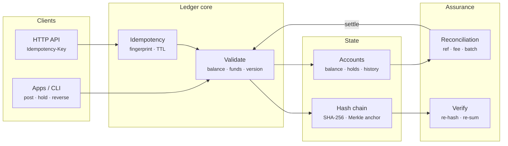

# Prism Ledger — Architecture

In a wallet or payments business, the ledger is the source of truth for who owns what. It has to hold up against mobile retries, concurrent requests, partial captures, refunds, processors that settle in batches net of fees, banks that add charges, and anyone with database access. Prism Ledger implements the patterns used by modern ledger services (double-entry with per-currency balancing, idempotency, holds, immutable history), adds cryptographic tamper evidence, and closes the loop with reconciliation against the bank.

## System diagram

## How it works

1. **Normalise** — Each leg is resolved to an account in this tenant. Sides are checked, string amounts are parsed into exact minor units, and currencies must match the account.
2. **Replay check** — If the idempotency key was seen within the TTL, the payload fingerprints are compared: a match replays the original journal, a mismatch is a conflict.
3. **Validate** — The engine checks that debits equal credits per currency and that no account is frozen. It also checks optimistic version preconditions, and that no account without overdraft would end up below its holds.
4. **Apply + chain** — Balances, versions and per-account history are updated, then the journal is hashed onto the tenant's chain. Nothing in this step can fail.
5. **Reconcile** — Expected cash movements are matched to bank lines. Matching a settlement batch posts the bank and fee journal, and leftover lines become categorised breaks an operator can book.

## Design decisions

- **Validate everything, then apply.** `prepare()` computes every account delta and checks every rule without mutating state; `apply()` only does arithmetic. That is what makes a journal atomic without transactions.
- **Integers only.** Amounts are integer minor units checked with `Number.isSafeInteger` (±90 trillion rupees). Integer numbers in the API are minor units; decimals must be strings, so `12.5` is rejected instead of being guessed at.
- **Fingerprinted idempotency.** The fingerprint is computed from the normalised legs, ref, memo and meta, so `"10.00"` and `1000` paise are the same request. A different payload under the same key is a conflict, never a silent replay.
- **One chain per tenant.** Tenants never share accounts, keys or hashes. A Merkle root over all tenant heads gives a single value to publish, for example in a daily email to auditors or on a public timestamp service.
- **Verification re-sums too.** Hashes catch edits to journals, while recomputing balances catches someone changing a balance column directly.
- **Reconciliation that posts.** A matched settlement batch produces the bank and fee journal, so the books follow the bank instead of guessing at fees in advance.

## Production notes

The core rules are complete and tested. A production deployment also needs:

- Durable storage with serialisable transactions (Postgres with `SELECT … FOR UPDATE` on account rows, or a dedicated store such as TigerBeetle), with the journal as the append-only system of record and balances as a projection.
- Horizontal scale by tenant or account shard, with cross-shard transfers going through a clearing account or two-phase commit.
- Idempotency keys persisted with the journal and enforced by a unique index, and the TTL matched to client retry policies.
- External anchoring of the Merkle root (a signed daily statement, or an RFC 3161 timestamp), plus write-once storage for exports.
- Real bank statement ingestion (MT940, CAMT.053, BAI2) and processor settlement reports, which carry batch IDs and make matching exact.
- Regulatory reporting, safeguarding checks (cash ≥ customer funds) and maker-checker approval for manual journals.
